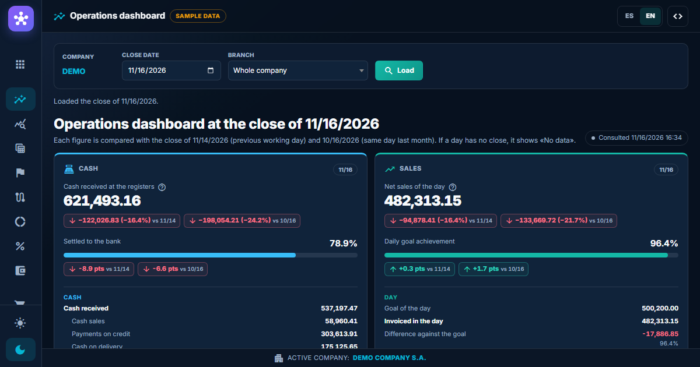

# Business UI Gallery

Business software screens rebuilt with sample data, organized by area: sales, inventory, accounting, treasury, budgets, payroll, health and IT. **Spanish and English** (switch in the top bar).

**Live demo:** https://robertomz.github.io/business-ui-gallery/



I build and maintain an internal ERP for a distribution company: a Django platform with 20+ modules that replaced a legacy Visual FoxPro system. That code is private, so this gallery rebuilds the screens I work on every day, keeping their layout, look and business rules, with generated data and no company information, so anyone can open and try them.

## Screens

37 screens in 9 areas. The home page shows one card per area; each area has its own page, and the sidebar shows only that area's screens until you press **Show all screens**.

| Area | Screen | What it shows |
| --- | --- | --- |
| Sales & operations | Sales dashboard | Day close by payment method and branch, same-weekday comparison, a summary that reconciles line by line |
| Sales & operations | Sales detail report | 10,000 rows with searchable filters, virtual scrolling and totals that follow every filter |
| Sales & operations | Operations dashboard | Executive daily close with sparklines and deltas: cash, sales, receivables, payables, stock |
| Sales & operations | Sales goals | Goal vs actual with a working-day pace, projection and traffic-light status |
| Sales & operations | Route planning | Weekly visit plan per route, copy across routes, compliance and unplanned sales |
| Sales & operations | Order fill rate | Ordered vs invoiced, fill rate by line and value, lost sales by reason |
| Sales & operations | Commissions | Tier editor with validation, calculation per seller and month-end close |
| Sales & operations | Accounts receivable | Aging, account statement and collection effectiveness at 20 and 40 days |
| Inventory | Automatic purchasing | Suggested orders from sales velocity, lead time and safety stock, with a status per line |
| Inventory | Suggested order | Order from purchase history with barcode search, stock check and volume discounts |
| Inventory | Legacy item matching | Data migration: old-system items matched to the new catalog, duplicates merged after a dry run |
| Inventory | Price check | Margin over sale per price list, cost-change alerts, price approvals and a cost increase simulator |
| Inventory | Stock by warehouse | Presentations, stock and cost per warehouse with an insert-only audit log |
| Accounting | Journal entries | Debit or credit per line, budget rule for expense accounts, saves only when balanced |
| Accounting | Automatic entries | Day-by-day generation from source documents with progress and cancel |
| Accounting | Journal book | Every entry with its balance check and the source document behind it |
| Accounting | Entry reconciliation | Expected (documents) vs posted (accounting) by code and day, with the reason for each difference |
| Accounting | Balance sheet | Account tree level 1 to 5 and the assets = liabilities + equity check |
| Treasury | Bank payment | Check or transfer applied to open invoices, exchange rate, amount in words, entry preview |
| Treasury | Payment schedule | Payables by due week turned into an approved payment list |
| Treasury | Payment request | Document lines where expense accounts must be budgeted for the cost center |
| Treasury | Credit cards | Limits, balances, charges by cost center and the monthly payment with its entry |
| Budget & control | Cost centers | Budget, projection and actual per center, adjustment requests and approvals |
| Budget & control | Budget vs actual | Account by month matrix with variance and drill-down |
| Budget & control | Expense verification | Receipts matched to posted expenses with a score per cost center |
| Budget & control | Balanced scorecard | Weighted KPIs with monthly targets and approval states |
| People | Payroll run | Earnings, deductions, employer contributions, bank file and accounting entry |
| People | Employee file | Contract, position, vacations, documents and history in one record |
| People | Attendance | Clock-in import, late arrivals and overtime, and the cut-off for payroll |
| Health & clinics (concept) | Clinic dashboard | The day at a glance: appointments by status, waiting time, no-shows, doctors' occupancy and income by service |
| Health & clinics (concept) | Appointments | Weekly schedule per doctor: book, confirm, check in and reschedule without double booking |
| Health & clinics (concept) | Patients | Registry with search, allergies and alerts, insurance and a validated new-patient form |
| Health & clinics (concept) | Medical record | Vitals, consultation timeline, diagnoses, prescriptions and attachments |
| IT & services | Network map | Topology of branches and devices with status and a simulated scan |
| IT & services | Maintenance planner | Preventive maintenance calendar with overdue alerts and checklists |
| IT & services | Service desk | Ticket board with SLA timers and drag and drop |
| IT & services | Dashboard builder | Drag-and-drop canvas to build dashboards from widgets |

The **Health & clinics** screens are concept screens: designed as samples of what I can build for clinics and doctors, not taken from a system in production. Every other screen is rebuilt from software in daily use.

## Rules these screens follow

- **Totals follow the table.** Every KPI and footer total is recalculated from the rows left after each search or filter.
- **Summaries reconcile.** Reports go from the total to its parts to the result, so the numbers can be checked by hand.
- **Generated entries have one line per account and side.** The breakdown lives in a detail table, not in the entry.
- **Big tables are never paginated.** Virtual scrolling keeps 10,000 rows fast.
- **Forms validate next to the field** and money fields accept only valid amounts (1,000.00).
- **Color is never the only signal.** Status uses an icon and text too, in light and dark themes.
- **Every figure explains itself.** The **?** buttons say how a number is calculated, and each report ends with an "About this report" box.
- **Two languages.** Every text exists in Spanish and English; the choice is remembered and the first visit follows the browser language.

## Tech

Plain HTML, CSS and JavaScript, with jQuery, DataTables (Scroller), Select2, Chart.js, vis-network and GridStack from CDNs. There is no build step and no backend: sample data is generated in the browser with a seeded random generator, so it is the same on every visit.

In production these screens run on Python/Django with MySQL and SQL Server stored procedures, deployed on AWS with a GitHub Actions CI/CD pipeline.

## Run locally

```bash
python -m http.server 8000
```

Then open http://localhost:8000.

## Author

Roberto Mejía · [LinkedIn](https://www.linkedin.com/in/roberto-mejia-dev) · [GitHub](https://github.com/robertomz)
